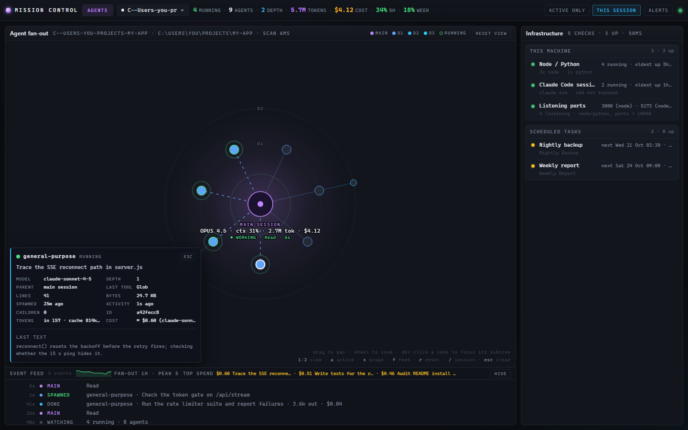

# mission-control

A local, read-only web dashboard that shows every Claude Code session and subagent running on your Windows machine, with its cost, limits and infrastructure, live.



The left panel lists Claude Code sessions and the subagents each one spawned. The right rail shows infrastructure checks, such as scheduled tasks and sites. The page updates itself over Server-Sent Events. Plain Node, zero npm dependencies.

## Requirements

- **Windows 10 or 11.** It is Windows-only: the launchers are PowerShell and scheduled tasks are read through Task Scheduler (`Get-ScheduledTask` / COM).
- **Node 20+.** It has zero npm dependencies, so there is no `npm install`.
- **Claude Code.** The dashboard reads the files Claude Code writes under `~/.claude/projects/`.

## Install

```powershell
git clone <this repo> mission-control
cd mission-control
node server.js
```

Then open <http://127.0.0.1:7373>. Or use the launcher, which starts the server, waits for it to answer and opens the browser (`Ctrl+C` stops it):

```powershell
powershell -NoProfile -ExecutionPolicy Bypass -File .\start.ps1
.\start.ps1 -Port 7500      # different port
.\start.ps1 -NoBrowser      # don't open a browser
node server.js --port 7500  # or skip the launcher (PORT env var also works)
```

If the port is already taken, the launcher says so and exits instead of failing silently.

`bin/autostart.ps1` is an optional watchdog for a scheduled task (at logon, or every few minutes). It starts `node server.js` hidden if nothing is listening on the port, with stdout going to `server.log` and stderr to `server.err` in the project root, and otherwise exits quietly:

```powershell
powershell -NoProfile -ExecutionPolicy Bypass -WindowStyle Hidden -File bin\autostart.ps1
```

### Wire up the status line (recommended)

`bin/statusline.js` is a Claude Code [status line](https://docs.claude.com/en/docs/claude-code/statusline) command. Claude Code pipes a JSON blob to it on stdin whenever the session changes. The script does two things with it:

1. It writes `data/statusline/<session_id>.json`. That record holds the received time, session id, transcript path, cwd, model, `cost`, the context-window numbers, `rate_limits` and the version. It writes a `.tmp` file first and renames it into place, so the dashboard never reads half a file. That is where the dashboard gets Claude Code's own cost figure (the number `/cost` prints) and the 5-hour and weekly limit windows.
2. It prints one line for the terminal footer, for example `[Opus] · ctx 23% · $4.10 · 5h 41% (2h10m) · wk 12%`.

It never fails loudly. On any error it still prints something and exits 0. The empty payload Claude Code sends when the setting changes is ignored. Add this to `~/.claude/settings.json`, using the absolute path to your clone:

```json
{
  "statusLine": {
    "type": "command",
    "command": "node <path>/mission-control/bin/statusline.js"
  }
}
```

Without it the dashboard still works. Costs are then estimated from transcript token counts and `lib/pricing.json`, and the limit gauges stay empty.

## Configure

Everything is optional. With no config the dashboard shows all sessions and no project-specific rows.

Copy `data/config.example.json` to `data/config.json`, which is gitignored. `since` and `sinceSession` are re-read every 60 seconds, so editing them needs no restart; `watchedTasks` and `modules` are read once at boot, so restart after changing those. If the file is missing, unreadable or malformed, no filter is applied and the reason is logged once at boot.

| Field | Meaning |
| --- | --- |
| `since` | ISO timestamp. Sessions that started earlier are hidden unless the request carries `?older=1`. |
| `sinceSession` | A session id that is always shown, whatever `since` says. |
| `watchedTasks` | Array of `{ "id", "taskName", "label" }`: Windows Task Scheduler tasks shown in the infra rail. Default: none. |
| `modules.stack` | `{ "enabled": false, "baseUrl", "root", "localPort", "label", "map", "profile", "formerIds", "infra" }`. The optional project module (off by default): a system map of one web app you run, plus project rows on the infra rail. `label` names it in the UI (default `Stack`). `map` describes the app for the built-in map profile (health components, subsystems, dependencies, schedules, edges; the shape is documented at the top of `lib/stack-profile.js`). `profile` is an optional path to your own profile module (`~` and repo-relative paths work; `data/*.local.*` is gitignored) for an app the built-in profile cannot describe (the interface is at the top of `lib/stack.js`). `formerIds` lists ids the module had before a rename, so saved UI state carries over. `infra` is an optional rail profile (extra HTTP services, in-process schedules, a HOLD file, resident processes); every name in it is yours, see `data/config.example.json`. It stays off unless `enabled` is `true` and `baseUrl` is set. |

Environment variables and flags read by `server.js`:

| Variable / flag | Default | Effect |
| --- | --- | --- |
| `--port N` / `--port=N` / `PORT` | `7373` | Listen port. |
| `--host a,b` / `--host=a,b` / `MC_HOST` | none | Extra addresses to listen on, comma-separated. `127.0.0.1` is always added. |
| `MC_CONFIG_FILE` | `data/config.json` | Config file path. |
| `MC_HISTORY_FILE` | `data/history.json` | History file path. |
| `MC_HISTORY_OFF=1` | off | Record no history (`/api/history` still answers, with empty series). |
| `MC_MONITOR_MS` | `60000` | Idle sampling period when no browser is connected. `0` disables it. |
| `MC_TOKEN` | generated | Access key for non-loopback clients. Otherwise a random key is stored in `data/token.txt`. |
| `MC_TOKEN_OFF=1` | off | Disables the token gate entirely. Logs a loud warning on every boot. Do not leave it on. |
| `MC_ACTIVE_WINDOW_MS` | `120000` | How recent activity must be for a session to count as active. |
| `MC_INFRA_TIMEOUT_MS` / `MC_STACK_TIMEOUT_MS` | `8000` | Per-probe timeouts. |
| `MC_SCAN_TIMEOUT_MS` | `20000` | Hard timeout around a whole scan. |

Runtime files are gitignored: `data/history.json`, `data/config.json`, `data/token.txt`, `data/statusline/`, `data/*.ok`, `*.log`.

## Panels

**Agents (left).** One card per Claude Code session, each listing the subagents it spawned. Each subagent shows its type, description, model, spawn depth and parent. It also shows how long it has been running, how long it has been idle, its output size and the last tool it used. A session is marked active when it has had recent activity.

**Infra (right).** Grouped service checks: whether a site answers, and whether a scheduled task is armed or disabled and when it next runs. Each item has a state (`up`, `down`, `armed`, `idle`, `disabled`, `hold`, `unknown`) and a `detail` line, which is where countdowns appear. Out of the box the rail holds the tasks you list in `watchedTasks`. The stack module adds your project's rows.

**Stack (optional module, off by default).** A tiered system map of one web app you run (edge, runtime, app, dependencies, jobs, this machine): tiers of nodes and the edges between them, under a summary line. The tab and its labels use `modules.stack.label`. The summary carries the live status, the deployed commit and how long the health probe took. Without `modules.stack` configured, this view has nothing to show.

Agents update every 2 seconds, infra and the stack map every 30 seconds. The browser does not poll, and there is nothing to refresh.

## Where the data comes from

- **Agents:** the subagent sidecar files Claude Code writes under `~/.claude/projects/<project-slug>/<session-id>/subagents/`. There is a `.meta.json` per subagent plus its output log. The session transcripts provide the token usage. The left panel is derived entirely from those files and their mtimes, plus the status-line records above.

  Reading every agent of every session is expensive. On a busy machine the full snapshot runs to hundreds of KB, far too much to push every two seconds. So sessions are **deep-scanned selectively**. A deep-scanned session carries its full `agents` array and `shallow: false`. Every other session comes back with `agents: []` and `shallow: true` but keeps its header fields (`agentCount`, `runningCount`, `isActive`, ...), so the list still renders with correct counts. By default only *active* sessions are deep-scanned:

  | Request | Deep-scans |
  | --- | --- |
  | `/api/agents` | active sessions only (default) |
  | `/api/agents?session=<id>` | that one session |
  | `/api/agents?session=all` | everything (the expensive escape hatch) |
  | `/api/stream?session=<id>` | active sessions plus that one, for the life of the connection |
  | `/api/agents?older=1` | everything, including sessions older than `since` |

  A session id must match `[0-9a-f-]{8,64}`. Anything else returns `400`.
- **Infra HTTP checks:** plain HTTPS requests from this machine to the configured endpoints.
- **Scheduled tasks:** `Get-ScheduledTask` / `Get-ScheduledTaskInfo` via PowerShell.
- **Stack module (only when enabled):** HTTPS probes of `baseUrl` (`/api/health`, `/api/version`, `/api/config`, `/api/status/incidents`). It also reads the git state of the local checkout at `root`, whose HEAD is compared with the deployed commit, and probes the local dev server on `localPort` if one is running.
- **Cost:** the status-line records when present. Otherwise transcript token counts are priced with `lib/pricing.json`. That file is a hand-maintained snapshot of Anthropic's public per-token pricing, dated inside the file. It is not fetched live, so update it when prices change.

The server only ever writes `data/history.json` (plus a `.tmp` beside it while a flush is in progress) and, when a non-loopback client first needs one, `data/token.txt`. `data/config.json` is only read. Nothing else on the machine is written to.

## History

Every *fresh* scan is appended to a rolling time series. A snapshot served from a cache is never recorded again: a point whose timestamp is not newer than the last one is dropped. Three series are kept:

- `agents`: `{ t, running, agents, sessions }`, sampled at most once every 10 seconds, since agents frames arrive every 2.
- `stack`: one point per Stack scan, `{ t, status, ms, role, unshipped, incidents }`. Here `status` is `ok` / `degraded` / `down` / `unreachable` and `ms` is the health-probe round trip. Empty unless the Stack module is on.
- `services`: one point per deployed service per infra scan, `{ t, up, ms }`, keyed by the item ids of the infra rail's deployed-services group. That group is data-driven and comes from the Stack module.

Each series keeps 7 days and at most 30,000 points, oldest first out, which keeps the file under a few MB. The file is rewritten at most once a minute, only when something changed, by writing a `.tmp` and renaming it over the top. A crash mid-write therefore cannot destroy the history.

History would only build up while a browser tab is open, so the server also samples on its own. With **no** SSE clients connected it runs an infra + stack + agents scan every 60 seconds (`MC_MONITOR_MS`) and records the result. When a browser connects, the idle monitor pauses and the 30-second SSE loop takes over the recording, so there is never more than one scan per period. The log shows the handover: `monitor: idle sampling every 60s (no clients)` and `monitor: paused (sse clients connected)`.

The server flushes on `SIGINT`, `SIGTERM` and `beforeExit`, so `Ctrl+C` writes everything out. A hidden server killed with `Stop-Process` gets no exit hook on Windows, so up to 60 seconds of samples can be lost. That bound is why the flush interval is 60 seconds.

## HTTP surface

| Route | What it returns |
| --- | --- |
| `GET /` | `public/index.html` |
| `GET /app.js`, `/style.css`, ... | static files inside `public/` only |
| `GET /api/agents` | `AgentSnapshot` JSON. `?session=<id>` / `?session=all` to deep-scan, `?older=1` to include sessions older than `since` |
| `GET /api/infra` | `InfraSnapshot` JSON (cached 25 s) |
| `GET /api/stack` | `StackSnapshot` JSON (cached 30 s) |
| `GET /api/history` | `HistorySnapshot` JSON. `?hours=` (1-168, default 24) and `?maxPoints=` (50-2000, default 720). Values outside those ranges return `400`. Downsampled into time buckets, where each bucket takes the *worst* status it saw, so an outage is never averaged away. `Cache-Control: no-store` |
| `GET /api/stream` | SSE: `agents` @2 s, `infra` @30 s, `stack` @30 s, `ping` @15 s. Supports `?session=<id>` and `?older=1` |
| `GET /api/health` | `{ ok, uptimeMs, port, agentsLib, infraLib, stackLib, reloads, libs, hosts }`, plus `history: { points, file, lastFlushAt, monitor }` and `config: { since, sinceSession }` |
| anything else | 404 JSON |

Agent snapshots carry `filter: { since, sinceSession, includeOlder, hidden }`, where `hidden` counts the sessions left out (`0` when `older=1`). Any value of `older` other than `1` is ignored, not rejected.

## How it works / why it's built this way

**Zero dependencies.** The server is `node:http`, `fs`, `child_process` and `crypto`. There is no framework, bundler or `node_modules`. The front end is plain HTML, CSS and JavaScript served from `public/`. A dashboard that watches your machine should not itself be a supply-chain risk or need a build step. It clones and runs.

**Read-only probes that never reject.** Each scanner (`lib/agents.js`, `lib/infra.js`, `lib/stack.js`) only reads: files, process and port lists, Task Scheduler, HTTPS endpoints. Every probe has its own timeout (`MC_INFRA_TIMEOUT_MS`, `MC_STACK_TIMEOUT_MS`). A failure becomes data, such as a `down`/`unknown` item or an entry in the snapshot's `errors` array, not an exception. Fan-out work goes through a bounded-concurrency map that never rejects. On top of that, the server wraps each whole scan in a hard timeout (`MC_SCAN_TIMEOUT_MS`), so one hung PowerShell call cannot stall the dashboard. The UI never sees a 500. A missing or broken scanner still yields a valid, empty snapshot with the problem described (`/api/stack` answers `503` with the loader error).

**Hot-reloadable scanner registry.** `server.js` holds a small registry (`LIBS`) that maps each scanner name to its file and export. One `fs.watch` on `lib/`, debounced per file, reloads a scanner when it is saved. If the new version throws on load, the previous module stays in service, so a half-written file cannot take the dashboard down. Reloads are logged (`lib/infra.js reloaded (v3)`) and counted under `reloads` in `/api/health`. The `libs` object there shows each scanner's file, export and current loader error. A successful `infra` or `stack` reload also drops that scanner's cache. Scanners are loaded lazily and picked up automatically once the file exists. `lib/history.js` is deliberately not in the registry; editing it needs a restart.

**SSE with cached, single-flight scans.** The browser holds one `EventSource`, and the server pushes frames instead of being polled. Scans are cached (infra 25 s, Stack 30 s) and single-flighted: concurrent requests for the same selector join the scan already running instead of starting another. Each stream tick runs **one** agents scan for all connected clients, covering the union of the sessions they asked to deep-scan. Five open tabs therefore cost one pass over the disk and one set of PowerShell calls. Frame sizes are logged (`agents frame 48.2 KB  deep=[...]  scan 93ms  clients=2`) so the cost is visible.

**Loopback-exempt token gate.** The server always binds `127.0.0.1` and binds other addresses only when you ask for them. Requests from loopback are never gated, so the local browser, the launchers and scripts need no key. Anything from another address must present a key. It arrives once as `?key=`, which is swapped for an `HttpOnly; SameSite=Strict` cookie and a redirect. Failures are rate-limited per address, and a presented value is never logged. Loopback is the boundary because anyone already on the machine can read the same files the dashboard reads.

**History ring flushed to disk.** History is an in-memory ring per series, capped by age (7 days) and count (30,000). It is flushed at most once a minute through write-to-`.tmp`-then-rename, so the file is always either the old version or the new one. An idle monitor keeps sampling when no browser is open, so the history has no gaps.

**Status-line hook writing per-session records atomically.** Claude Code already knows its exact cost and rate-limit windows and hands them to the status-line command. Rather than re-deriving those numbers, `bin/statusline.js` persists that payload, one file per session, through a `.tmp` + rename. The dashboard therefore never reads a torn record, even though Claude Code rewrites it constantly. The hook has to stay invisible, so it never throws and always prints a line.

## Phone access (Tailscale)

The simplest route is Tailscale's built-in proxy in front of the loopback server:

```powershell
tailscale serve --bg --http=80 7373      # once; persists across reboots
tailscale serve status                   # shows http://<machine>.<tailnet>.ts.net (tailnet only)
tailscale serve --http=80 off            # to stop publishing it
```

The phone then opens `http://<machine>.<tailnet>.ts.net`. Only devices signed into your tailnet can reach it (this is `serve`, not `funnel`), and SSE streams through it.

**Be aware:** with `tailscale serve` the proxy connects to the server from `127.0.0.1`, and loopback is never gated. So **every device on your tailnet gets in without the key.** That is fine for a single-user tailnet. It is not fine for a shared one. On a shared tailnet, use the direct route below instead, which goes through the token gate.

### Direct route (token-gated)

To listen on another address as well, pass `--host` or set `MC_HOST`. The value is comma-separated, and `127.0.0.1` is added whether or not you list it:

```powershell
$env:MC_HOST = '100.x.y.z'          # your Tailscale IP
node server.js
# or
node server.js --host 127.0.0.1,100.x.y.z
```

One `listening on http://<addr>:7373` line is logged per address. A non-loopback address may fail to bind with `EADDRNOTAVAIL`, which is what you get when Tailscale has not brought its interface up yet after a reboot. In that case the server says so, keeps serving on loopback and retries that address every 30 seconds. `/api/health` carries a `hosts` array of `{ addr, listening }`.

Windows blocks the inbound connection even once the server is listening. Run this once from an **elevated** PowerShell:

```powershell
New-NetFirewallRule -DisplayName "Mission Control (Tailscale)" -Direction Inbound -Protocol TCP -LocalPort 7373 -InterfaceAlias "Tailscale" -Action Allow
```

`-InterfaceAlias` restricts the rule to the Tailscale network adapter (check its name with `Get-NetAdapter`), so it does not open the port to whatever Wi-Fi you are on.

### The token gate

- The key is `MC_TOKEN` if set. Otherwise it is a 32-byte random hex value, generated on first need and stored in `data/token.txt` (gitignored).
- At boot, when a non-loopback host is configured, the server logs a **masked** phone URL: `phone url: http://<addr>:7373/?key=abcd...`. Only the first 4 characters are shown, plus where the full key lives. The full key is only ever in `data/token.txt` or `MC_TOKEN`, never in the log.
- First visit from the phone: `http://<addr>:7373/?key=<full key>`. On a match the server sets an `HttpOnly; SameSite=Strict; Path=/` cookie `mc_key` lasting **30 days**. It then redirects to the same URL without `key`, so the key leaves the address bar and the browser history.
- Without a valid key, `/api/*` and static files return `401 {"error":"unauthorized"}`. A page request gets a small form to type the key into, which is the practical way in on a phone.
- Failed attempts are limited to 10 a minute per remote address; after that it is `429` until the minute is up. Denials are logged as `gate: denied <addr> (n)`.
- `MC_TOKEN_OFF=1` disables the gate. Anyone who can reach the port can then read the dashboard, which shows local paths, project names and prompts.

Binding `0.0.0.0` is the wrong move: it exposes the port on every network the machine is on, not just the tailnet.

## Limitations

- **Windows-only.** It uses PowerShell launchers, Task Scheduler and `USERPROFILE`. Porting the infra scanner to another OS would mean replacing those probes.
- **"done" is inferred, not reported.** A subagent counts as finished because its output file stopped changing, not because anything signalled completion. A long, quiet tool call can look done, and a finished agent only flips over once the idle threshold passes.
- **The `.meta.json` sidecar format is internal to Claude Code** and can change in any release without notice. If the left panel suddenly empties after an update, check `~/.claude/projects/<slug>/<session>/subagents/` against what `lib/agents.js` expects.
- **`lib/pricing.json` is a hand-maintained snapshot** of Anthropic's public pricing, used only when no status-line record is available. It goes stale when prices change.
- **Stack-module dependencies show as `wired`, not probed.** `wired` means the app is configured for that dependency, not that mission-control reached it. Only `baseUrl` and the local dev server are actually requested.

## Tests

```powershell
npm test                    # = node lib/modules.test.js && node lib/stack.test.js
node lib/modules.test.js    # config resolution (pure node, no network)
node lib/stack.test.js      # stack engine + built-in profile against a stub app on 127.0.0.1
```

## License

MIT. See [LICENSE](LICENSE).

Issues welcome; pull requests are not accepted right now.
